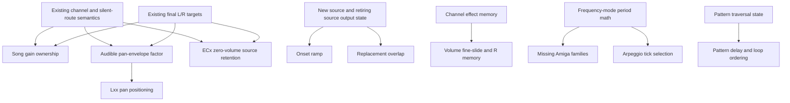

# FT2/XM closure matrix

## Supported target and authority

The milestone asks: **what would still make a supported XM sound or behave
observably differently in FT2?** The milestone is **open**. This evidence-only
matrix changes no playback behavior, admission rule, file format, or ADR.
Evidence baseline: synchronized main `7ec40947af0e15a22a8ec7227ac88c535714bef6`,
audited 2026-10-01 with fresh reports, not prior closure-branch artifacts.

The target is loaded original FT2/XM with exact instrument/keymap/sample identity,
including declared empty routes, Linear mode and the loaded Amiga paths below.
Editable documents retain their existing Linear subset. Original FT2 commands
listed as gaps require implementation or an accepted, scoped deferral before
closure; today's `Deferred` support label alone is insufficient. MOD reading,
read-only loaded-source ownership, and [ADR 014](decisions/014-loaded-xm-editable-copy-planning.md)
remain protected. OpenMPT extensions, native editable Amiga creation and callback
RT-safety work are separate contracts.

Production code and tests define current behavior; [effect support](xm-effect-support.md)
defines command-family support and [the roadmap](roadmap.md) defines sequencing.
ADR 014 owns editable-copy admission. Reference
observations use pinned ft2-clone
[`87be42543dac82cf802b5bddad917bda62ace131` replayer](https://github.com/8bitbubsy/ft2-clone/blob/87be42543dac82cf802b5bddad917bda62ace131/src/ft2_replayer.c)
and [audio host/mixer integration](https://github.com/8bitbubsy/ft2-clone/blob/87be42543dac82cf802b5bddad917bda62ace131/src/ft2_audio.c).
An external observer executes its unchanged loader, tick dispatch and mixer,
with stereo Float32, Linear interpolation, volume ramping on, amplification 10,
master volume 256 and Precise BPM off. VTX comparisons use the matching FT2
profile, gain 1 and integral 125-BPM tick lengths at 48/44.1 kHz. This is a pinned
reference experiment, not a claim about every clone configuration.

Each row has one primary class. `CLOSED` applies only to its stated bounded
contract; `PARITY-WATCH` means implemented with unclosed interactions. Confirmed
gaps distinguish parent, memory, timing, audible foundation and Amiga math.
`KNOWN-REFERENCE-DIFFERENCE` is an open compatibility obligation unless explicitly
excluded or justified; `NEEDS-CHARACTERIZATION` makes no invented parity claim.
The support reference separates support, FT2 closure, memory and pitch-mode
coverage. This matrix's `MISSING-PARENT`, `MISSING-MEMORY`, `MISSING-TIMING`,
`MISSING-AMIGA-MODE-PATH`, audible-foundation and retained-difference classes
explain why closure remains open; `NOT-V1` applies to an actual target exclusion.
An FT2-inert byte can be closed while an audible extension for that byte is NOT-V1.

## Closed foundations

| Bounded behavior | Class | Current evidence and boundary |
| --- | --- | --- |
| G01 sample-header/channel-volume ownership | CLOSED | [XMVolumeOwnershipTests](../tests/vtx_render_bounded_xm/XMVolumeOwnershipTests.swift), note-only and runtime cursor controls: header 0/16/64 initializes/restores defaults; song output consumes them once. Exact mapped zero-header PCM stays active while silent and later Cxx reveals its continuing cursor; empty/unrepresented routes stay source-less and preview policy is unchanged. Both-rate constant-source controls match settled FT2 levels within `6e-8`, with exact VTX runtime/whole/window agreement. |
| G02 new-source onset | CLOSED, bounded 5 ms contract | [Onset contract](design/xm-reset-output-ramp.md#g02-new-source-onset), `NewSourceOnsetTests`, original `new-source-onset.xm` and accepted [PR #509](https://github.com/syncomm/voodootrackerx/pull/509): independent incoming `k/N` output preserves scheduled birth and continuous cursor, with zero first output, midpoint 0.5 and unity at age 240/220 at 48/44.1 kHz. Qualified tests/CI and Gregory's independent listening acceptance close this contract. G03 outgoing retirement and G21 offline E9/Rxy retirement have separate bounded closures; no universal FT2 PCM-equality claim. |
| G03 displaced-song-source retirement | CLOSED, bounded 5 ms contract | [Retirement contract](design/xm-reset-output-ramp.md#g03-same-channel-outgoing-source-retirement), `SongSourceRetirementTests`, extended R02/runtime controls and accepted [PR #510](https://github.com/syncomm/voodootrackerx/pull/510): current-value `1-k/N` output has one immutable deadline per outgoing generation, preserving physical pitch/cursor and G02's independent incoming attack. Both rates/modes, distinct signed sources, rapid generations, exact continuation, bounded pooling and pinned first/interior/endpoint convention are covered. Green CI and Gregory's October 26, 2026 listening acceptance close this contract. G21 closes offline E9/Rxy retirement separately below. The qualified 48 kHz VTX musical-study numerical difference is classified separately below; broader host/offline qualification remains OPEN and #512's fixed strict Float32 failure stays distinct. G05 is closed separately; generic non-XM 32-frame ramps are unchanged. |
| G04 ECx retained-source note cut | CLOSED, bounded retained-source contract | [ECx contract](design/xm-reset-output-ramp.md#g04-ecx-retained-source-and-quick-output), [ECxRetainedSourceTests](../tests/vtx_render_bounded_xm/ECxRetainedSourceTests.swift) and runtime tests: ECx zeros canonical base/output at its actual tick through one shared 5 ms target while preserving the source, pitch, key and moving cursor for later Cxx recovery. Linear/Amiga at 44.1/48 kHz, EC0/EC3, Fxx/speed boundaries, silent routes, completion/replacement and exact whole/window/core PCM are covered. Pinned reference confirms ordinary EC0/EC3 shape and newborn EC0 silence; canonical CoreAudio PCM16 matches offline. Internal hard stop stays immediate; G02/G03/G05/G40 and unmeasured reference interactions remain separate. |
| G05 represented-XM final-output admission | CLOSED, bounded final-output admission | [Output contract](design/xm-reset-output-ramp.md) and accepted [PR #512](https://github.com/syncomm/voodootrackerx/pull/512): valid represented XM generations enter the single C-owned final mono/L/R authority at birth, including zero gain; previously plain sources receive sparse changed targets under existing ordinary tick-length/quick 5 ms policies. Green [native arm64 CI run #1054](https://github.com/syncomm/voodootrackerx/actions/runs/40521590031) follows the strict Float32 managed-contribution rounding repair, preserving exact assertions. Gregory's October 27, 2026 musical-listening acceptance closes this bounded contract; no universal FT2 parity or hardware measurement is claimed. G02/G03/G04, G32 physical IDs/order, exact source/keymap identity and generic non-XM/preview ramps remain protected; G40 remains open. |
| G32 instrument autovibrato | CLOSED, bounded VTX composition policy | Accepted [PR #507](https://github.com/syncomm/voodootrackerx/pull/507), public numeric/publication/runtime controls in both modes/rates and [approved arithmetic/reference-difference policy](design/xm-final-pitch-publication.md): independent phase/sweep composes after ordered native pitch intents, including folded births and blank-tick physical delivery; issue #488 is closed. Intentional reference differences remain explicit. G02/G03, G39 interactions, editor controls and backend freeze remain separate. |
| G33 Pxy panning slide | CLOSED, bounded stored-pan contract | Accepted [PR #514](https://github.com/syncomm/voodootrackerx/pull/514), [PanningSlideTests](../tests/vtx_render_bounded_xm/PanningSlideTests.swift), runtime controls and original public fixtures pin nonzero-tick stored-pan movement, own whole-byte P00 memory, priority/mixed nibbles, speed-1 admission, ordered column/P clamps, silent carry, G06/G07 projection and held-global non-refresh in both modes/rates. G33A pinned-reference characterization, qualified delivery/PCM and Gregory's October 27, 2026 listening acceptance close this bounded contract. G40/cold/pan-clock boundaries and legacy-engine cleanup remain separate. |
| G34 Txy tremor | CLOSED, bounded memory/output contract | Accepted [PR #515](https://github.com/syncomm/voodootrackerx/pull/515), [TremorTests](../tests/vtx_render_bounded_xm/TremorTests.swift), runtime controls and [offline admission tests](../tests/vtx_render_bounded_xm/OfflineControlAdmissionTests.swift) pin whole-byte T00 replay, signed durations, Fxx, reset/source carry and writer/envelope precedence in both modes/rates. Alternating held output uses the shared quick final mono/L/R target without changing base volume or source cursor. Gregory's accepted render/direct-XM listening, independent review and merged CI close this bounded contract. G05/G32 remain protected; broader host/offline qualification, G39/G40 and planning/RSS debt remain OPEN. |
| G36 E3x glissando | CLOSED, bounded post-merge tone-output contract | Accepted merged [PR #521](https://github.com/syncomm/voodootrackerx/pull/521) includes Gregory's qualified eight-WAV listening acceptance. [GlissandoTests](../tests/vtx_render_bounded_xm/GlissandoTests.swift), the original public fixture and [tone-output contract](design/xm-final-pitch-publication.md#g36-e3x-tone-output-glissando) pin E30/off and every nonzero/on alias, channel-local persistence, Linear/Amiga grid ties and crossings, tuning/E5, 3xx/300/5xy/Fx, Fxx/EEx, target clamps and source lifetime at both rates. Continuous base/target/direction/speed remain independent of projected audible intent; the existing G32 publisher composes from that intent. Matched reference and actual-host/offline controls qualify default-origin playback; direct selected-range adapter/prepared-runtime plans start cold. No-E3x identities, G21 retirement and native capacity remain protected. Eager order-0 prewarm can leak E3 into a product cold nonzero-order live start; #516 owns that OPEN integration. Full G37, G38/G39/G40/G41 and the integrated audit stay OPEN. |
| G37A initial/default-origin E6x slice | CLOSED, bounded initial-state contract | Accepted [PR #517](https://github.com/syncomm/voodootrackerx/pull/517), [ImplicitPatternLoopTests](../tests/vtx_render_bounded_xm/ImplicitPatternLoopTests.swift) and actual-host controls close initial/default-origin runtime plus direct selected-range adapter/offline semantics. Row-array zero is eligible only before that channel's first executed E60 in the actual traversal. Full G37 remains PARTIAL: cold live selected-order planning is blocked by [#516](https://github.com/syncomm/voodootrackerx/issues/516), and inherited-anchor/next-pattern-entry policy remains G38. |
| G35B-Q2 offline source admission | CLOSED, bounded offline delivery contract | [OfflineSourceAdmissionTests](../tests/vtx_render_bounded_xm/OfflineSourceAdmissionTests.swift) and [control admission tests](../tests/vtx_render_bounded_xm/OfflineControlAdmissionTests.swift) pin 497/745 sequential births, exact source-array summation/continuation, reset and whole/split/stream/window delivery. At frame 300, 32 physical stops vacate capacity for an atomic 256-source group; a true 257 group fails visibly. One native mixer retains the 256/4096 limits and 8 MiB selector budget. Exact copied-payload peaks are 54.50/55.75 MiB for the public pressure controls. High variable process RSS remains unresolved despite reusable VM pages, owned by the post-G41 planning/memory audit. G35 ordinary EEx uses this delivery foundation under its bounded closed contract; bounded local combined traversal is implemented by G38A; full G38 remains PARTIAL; [#516](https://github.com/syncomm/voodootrackerx/issues/516) is unchanged. |
| G06 audible pan-envelope factor | CLOSED | [XMPanningEnvelopeTests](../tests/vtx_render_bounded_xm/XMPanningEnvelopeTests.swift), shared runtime controls: observed byte-domain displacement joins the existing final-L/R target at 44.1/48 kHz. Neutral audio, static baseline, silent routes, sustain/loop/logical release, resets and carry are covered. This closes the output factor only; retained pan-clock/Q8/point-64 differences and G40 remain open. See [the owned contract](design/xm-reset-output-ramp.md#g06-panning-envelope-factor). |
| G07 Lxx panning-envelope positioning | CLOSED | [XMPanningEnvelopeTests](../tests/vtx_render_bounded_xm/XMPanningEnvelopeTests.swift), shared runtime-core controls: the sounding instrument's raw volume-sustain bit gates positioning, independent of volume enable/loop flags. Public gate/position/end/loop/release/reset/silent-route controls match pinned command-frame state at 44.1/48 kHz; whole/window/runtime-core tests preserve volume Lxx, G06 and exact routes. Maintainer-reported external full canonical Xcode testing and listening passed. This closes positioning only; pan fractional/Q8 arithmetic, G40 static/header/8xx final pan law and the pan-sustain/release difference remain open. See [the owned contract and external verification](design/xm-reset-output-ramp.md#g07-lxx-panning-envelope-positioning). |
| Nonzero Fxx speed/BPM from command-row tick 0, including channel precedence | CLOSED | `fxx-timing.xm`, timing tests and shared frame plan; F00 is excluded below. Do not reopen the completed timing correction. |
| Linear regular/fine/tone units, extra-fine units and volume-column Fx/F0 | CLOSED | [PortamentoScalingTests](../tests/vtx_render_bounded_xm/PortamentoScalingTests.swift), both scaling fixtures: regular/fine/tone use `4 * parameter`, extra-fine uses `parameter`, Fx uses `64 * nibble`. This does not close missing fine-slide memory. |
| Amiga note lookup/finetune, 2xx and effect-column 3xx/300 scaling | CLOSED | Quantized lookup and VTX's 4x FT2-period representation; fresh reference control matches all 9 tone and 10 down-slide updates after conversion. Do not reduce correct `16 * parameter` deltas or promote neighboring families. |
| Regular 1xx/2xx directional memory admission | CLOSED, supported-path prerequisite | [RegularPortamentoMemoryAdmissionTests](../tests/vtx_render_bounded_xm/RegularPortamentoMemoryAdmissionTests.swift) and public `regular-portamento-memory-admission.xm` pin first nonzero-tick admission, speed-1 seed/replacement refusal, cold history, independent directions, Fxx channel order and lifetime at both rates. Linear and Amiga 1xx/2xx share the rule; G27 adds upward Amiga execution without changing admission or lifetime. |
| Integer 4xy/E4x and 7xy/E7x modulation, nibble memory and controls; 6xy/600 shared nonzero-tick slide | CLOSED | [VibratoFoundationTests](../tests/vtx_render_bounded_xm/VibratoFoundationTests.swift), [AmigaVibratoTests](../tests/vtx_render_bounded_xm/AmigaVibratoTests.swift), [XMVolumeOwnershipTests](../tests/vtx_render_bounded_xm/XMVolumeOwnershipTests.swift); 185 observed tremolo output updates match FT2. Amiga unsigned wrap and zero-step hold/resume are covered. Full audible families retain G39 parity-watch. |
| Channel-owned envelope/release clocks, integer fadeout, silent declared routes and non-retrigger reset | CLOSED | [XMEnvelopeSemanticTests](../tests/vtx_render_bounded_xm/XMEnvelopeSemanticTests.swift), [XMResetOutputTests](../tests/vtx_render_bounded_xm/XMResetOutputTests.swift); volume sustain/loop/release, Kxx and interior volume Lxx are bounded contracts. Volume-Lxx loop/end positioning, cold before-first initialization, pan arithmetic/clock quirks and unusual precedence remain open. |
| One final-L/R authority for managed voices: ordinary tick targets, quick volume/reset targets, deduplication and window carry | CLOSED | [XMAudibleOutputTests](../tests/vtx_render_bounded_xm/XMAudibleOutputTests.swift), reset tests; ordinary targets rebase from prior target, quick resets from current audible output. Managed voices avoid a second generic ramp. New-source onset remains separate; G04 below extends the same authority to ECx. |
| Explicit mapped triggers/default caches, instrument-only reset, ordinary note-only routing and carried state | CLOSED | [NoteOnlyRoutingTests](../tests/vtx_render_bounded_xm/NoteOnlyRoutingTests.swift), volume-ownership/default-volume tests and public empty-slot/routing fixtures; no first-playable fallback, fabricated voice or source ownership. G01 concerns audible gain construction, not default-cache removal. |
| Seeded A00/500 memory and nonzero Axy/5xy slide scheduling; fine volume-column 8x/9x tick 0 | CLOSED | Existing adapter tests and fresh volume-column control. Zero fine-slide amount still restores output from base. Cold A00/G14 and Linear cold 500/G15 are closed below; 6xy timing is already corrected. |
| G08 ordinary volume-column 6x/7x timing | CLOSED | [VolumeColumnSlideTimingTests](../tests/vtx_render_bounded_xm/VolumeColumnSlideTimingTests.swift), public `volume-column-slide-timing.xm` and runtime tests: speeds 1/3/6, clamps, zero amounts, same-row Fxx/Cxx, trigger/continuation, silent/completed carry and envelope output. All 1,604 observed tick outputs match pinned FT2 at 44.1/48 kHz; whole/window/runtime plans agree with zero applied-frame delta. Canonical full Xcode testing and maintainer listening passed. Fine 8x/9x and A/5/6 memory remain independent; G40 stays open and bounded G31 volume arithmetic is closed separately below. |
| G09 volume-column Dx/Ex timing and D0/E0 | CLOSED | [VolumeColumnPanSlideTimingTests](../tests/vtx_render_bounded_xm/VolumeColumnPanSlideTimingTests.swift), public `volume-column-pan-slide-timing.xm` and runtime controls: nonzero ticks at speeds 1/3/6, clamps, D0 forcing zero/E0 preserving pan, Fxx, header/Cx/8xx precedence, silent/completed carry and G06/G07. At both rates, 2,608 initialized-state reference ticks match exactly; Cx was retained at G09 closure and is corrected separately by G11 below; the cold 127.5-versus-128 baseline remains. Whole/window/runtime-core targets agree; canonical host applies all 135 events per rate with zero delta and PCM within PCM16 tolerance. Full Xcode passes; G08 PCM and static header/Cx/8xx baseline WAVs were identical for the G09 change. G40 and broader onset/output interactions stay open; G05 admission is closed separately. |
| G11 volume-column Cx stored-pan mapping | CLOSED | [VolumeColumnPanningMappingTests](../tests/vtx_render_bounded_xm/VolumeColumnPanningMappingTests.swift) and shared runtime controls: all 16 column bytes match pinned FT2 at 44.1/48 kHz, from C0 = 0 through CF = 240 with C8 = 128; 750 observed stored-pan ticks agree per rate. Header/Cx/8xx precedence, silent/completed note-only carry, G09 and G06/G07 are covered. Whole/window/runtime targets use the corrected base under the unchanged G40 conversion/profile law. Canonical host applies all 261 events per rate with zero delta and PCM within PCM16 tolerance; full Xcode passes. Preview and exact header/8xx bytes remain unchanged. G40, envelope arithmetic and cold initialization remain separate. |
| G10 volume-column Ax/Bx shared vibrato | CLOSED | [VolumeColumnVibratoTests](../tests/vtx_render_bounded_xm/VolumeColumnVibratoTests.swift), public `volume-column-vibrato.xm` and runtime controls: Ax tick-zero speed, Bx nonzero-tick depth/execution, zero nibbles, speeds 1/3/6, shared 4xy/6xy memory, ordered mixed executions, E4 controls and exact empty routes. Retained FT2 controls match in Linear/Amiga at both rates; whole/window/runtime-core state, pitch and frames agree. Canonical-host delivery and full verification cover the bounded contract. G39, remaining Amiga families, onset, autovibrato and final pan law stay separate. |
| G12 nonzero Hxy timing and channel-turn publication | CLOSED | [GlobalVolumeSlideTimingTests](../tests/vtx_render_bounded_xm/GlobalVolumeSlideTimingTests.swift), public `global-volume-slide-timing.xm` and runtime controls: speeds 1/3/6, H12, clamps, Fxx, early/middle/late and opposed/same-direction/three writers. One canonical global state mutates in channel order; target snapshots can differ and plain targets persist until a volume publication. Volume envelopes/release refresh each tick and later notes inherit final canonical state. Whole/window/runtime-core and canonical-host checks cover both rates. G13 adds H00 memory below; generic ramps, onset, envelope arithmetic and static pan law remain separate. |
| G13 H00 effect-memory replay | CLOSED | [GlobalVolumeSlideMemoryTests](../tests/vtx_render_bounded_xm/GlobalVolumeSlideMemoryTests.swift), public `global-volume-slide-memory.xm` and runtime controls: independent full-byte H01/H10/H12/H21 memory, speed-one execution gate, lifetime across note/instrument/release/blank/order and source-less/completed/empty routes, clamps, Gxx, windows and both rates. Seeded replay uses G12 unchanged. Fresh plans clear memory. Cold H00 is a true no-op under the explicit artifact exclusion below. |
| G14 cold A00 base-to-output restoration | CLOSED, B compatibility convention | [ColdA00Tests](../tests/vtx_render_bounded_xm/ColdA00Tests.swift), public `cold-a00-output-restoration.xm` and both-rate runtime controls: valid zero-slide execution on nonzero ticks restores current base to output through causal local publication without inventing A/5/6 provenance. Speed/Fxx, base writers, envelopes, note/reset and silent/completed inheritance, retained tremolo/E7 state, real seeds and window/source-generation carry are covered. Manuals leave this cold boundary unspecified. Cold H00 remains excluded; Linear cold 500 is G15 below and generic ramp parity stays separate; cold 600 completion is below. |
| Cold 600 local-publication intent | CLOSED | [Cold600Tests](../tests/vtx_render_bounded_xm/Cold600Tests.swift) and public `cold-600-local-publication.xm`: the established nonzero-tick zero slide declares local publication, refreshing held gain 1 to .25 with unchanged base/output 64 and canonical global 16. Numeric 63→32 restoration, deduplication, speed/Fxx, real A/5/6 seeds, Linear/Amiga vibrato, silent/completed routes, envelope/fadeout and whole/window/runtime delivery remain pinned at both rates. No memory provenance is invented; G14 and cold-H00 exclusion remain intact; Linear cold 500 is G15 below. |
| G15 cold Linear 500 independent halves and local publication | CLOSED, A composition / B compatibility convention | [Cold500Tests](../tests/vtx_render_bounded_xm/Cold500Tests.swift), public `cold-500-local-publication.xm` and both-rate runtime controls: nonzero-tick zero-slide restoration/publication in all four target/speed states, honest absent memory, stale held gain refresh and deduplication. Seeded arithmetic/origins, no-retrigger targets, reached targets, speed/Fxx, tremolo/E7 continuation, silent/completed routes, envelope/fadeout and whole/window/runtime delivery are pinned. Redundant period-refresh flags are unnecessary (C); G28 reuses this writer for Amiga below. |
| G16 EA0/EB0 directional fine-volume memory and cold publication | CLOSED, A seeded memory / B cold compatibility | [FineVolumeMemoryTests](../tests/vtx_render_bounded_xm/FineVolumeMemoryTests.swift), public `fine-volume-directional-memory.xm` and both-rate runtime controls pin independent up/down/channel memories, tick-zero replay, cold base-to-output restoration with no provenance, held-target repair/deduplication, clamps, speed/Fxx, trigger/order/silent carry, tremolo continuation and envelope/fadeout composition. Cold H00 remains intentionally inert; A00/500/600 and G17/G18 stay separate. Existing ramps and G31 arithmetic are unchanged. |
| G17 Linear E10/E20 directional fine-pitch memory and cold restoration | CLOSED, A seeded memory / B cold restoration | [FinePitchMemoryTests](../tests/vtx_render_bounded_xm/FinePitchMemoryTests.swift), public `fine-pitch-directional-memory.xm` and both-rate runtime controls pin independent directional/channel memories, tick-zero speed/Fxx, current canonical-to-held restoration without provenance, converged deduplication, vibrato continuation, same-cell folding, order/lifetime carry, retained/completed/empty routes and parent clamps. Uninitialized pitch and completed C generations receive no publication. Source-less 0→1 and redundant flags are excluded below; G18 is closed separately below; G29 Amiga closure is separate below. |
| G18 Linear X10/X20 directional extra-fine memory and cold restoration | CLOSED, A seeded memory / B cold restoration | [ExtraFinePitchMemoryTests](../tests/vtx_render_bounded_xm/ExtraFinePitchMemoryTests.swift), public `extra-fine-pitch-directional-memory.xm` and both-rate runtime controls pin independent direction/channel/family amounts and origins, tick-zero speed/Fxx, cold canonical-to-held restoration without provenance, converged deduplication, vibrato/column continuation, same-cell folding, order carry, canonical-empty/completed/uninitialized eligibility and protected parent range. Source-less cold-X10 0→1 and redundant refreshes are excluded; inactive C generations receive no step write or new voice. Linear contract; G29 Amiga closure is separate below. |
| Gxx channel-turn fresh-trigger and held-target publication | CLOSED, B compatibility convention | [GlobalVolumePublicationTests](../tests/vtx_render_bounded_xm/GlobalVolumePublicationTests.swift), public `global-volume-publication.xm` and runtime controls: before/after/same-cell and two-writer births, blank holds, Cxx/repeated C40/Gxx/volume-column refresh, G00 repair, envelope ticks, silent/completed/empty routes and replacement generation rejection at both rates. Canonical state, birth snapshot and held gain stay distinct; whole/window/runtime consume causal events without pre-trigger gain fanout. G12/G13, cold-H00 exclusion, G31 arithmetic, onset and generic ramp/pan parity remain separate. |
| G19 E90 row-entry trigger | CLOSED, A intended FT2/XM behavior | Public `e90-row-entry-retrigger.xm`, NoteOnlyRoutingTests and both-rate offline/window/runtime controls pin one tick-zero generation at cursor zero, exact carried/explicit note+instrument routing, instrumentless volume/pan/envelope/release carry, explicit instrument reset before overrides, NOTE_OFF suppression, cold/completed/unavailable routes, offset and E9/Rxy independence. Finalized release annotations are inherited without releasing the new trigger again. Nonzero E9 behavior and mixer ramps remain unchanged. |
| G20 Rxy independent nibble memory resolution | CLOSED, A intended behavior | [RxyNibbleMemoryTests](../tests/vtx_render_bounded_xm/RxyNibbleMemoryTests.swift) and both-rate runtime controls pin zero-initialized channel-local speed/mode bytes, cold mixed sequences, provenance, lifetime, same-cell/gated resolution and E9/E90 independence. Positive-interval replay matches explicit-equivalent events and whole/window/runtime PCM in each path. G21 separately closes offline delivery of the existing native 5 ms outgoing-source retirement. G21 execution/counter/carry and G22 arithmetic are closed below; stride remains 1152. |
| G21 Rxy persistent counter, invocation timing and semantic carry | CLOSED, A intended behavior; narrow C exclusion below | Public `rxy-counter-timing-carry.xm`, RxyNibbleMemoryTests and both-rate whole/window/runtime controls pin speeds 1/2/3/6, Fxx, volume-column gates, interval-zero execution, counter/reset versus nibble-memory lifetime, same-cell coalescing, exact cursor-zero routing, completed/released restarts and envelope/fadeout carry. Initialized source-less volume changes survive later note-only triggers. Offline E9/Rxy outgoing-source retirement is closed under the separate bounded delivery contract below. G22 arithmetic is closed below; the counter fits existing ChannelState padding. |
| G21 offline E9/Rxy outgoing-source retirement | CLOSED, bounded post-merge delivery contract | [G21 retirement contract](design/xm-reset-output-ramp.md#g21-offline-e9r-outgoing-source-retirement), focused offline/runtime controls and actual CoreAudio comparisons in both modes/rates pin the shared native 240/220-frame retirement of each exact outgoing generation. Continued cursor, held pitch, reached onset, immutable overlapping deadlines and source/window checkpoints agree without shifting new births. No-E9/R controls remain unchanged; G20–G22 semantics, C DSP and existing capacity limits are unchanged. The qualified 48 kHz VTX musical-study numerical difference has its separate narrow policy below; broader host/offline qualification remains OPEN. No universal PCM equality is claimed. |
| G22 Rxy exact integer volume modes | CLOSED, A intended FT2 arithmetic | [RxyVolumeArithmeticTests](../tests/vtx_render_bounded_xm/RxyVolumeArithmeticTests.swift) pins all 1,040 mode/input pairs and repeated 6/7/E/F sequences from independent synthetic oracle observations. Mode 6 sums separately truncated `v/2 + v/8 + v/16`, including 32→22; every mode clamps to 0...64. The existing Rxy fixture distinguishes 1/6/7/9/E/F. Active, released, completed and initialized source-less integrations preserve G20 memory, G21 counter/timing/source carry, exact generations and both-rate whole/window/runtime delivery. G21 offline retirement closes separately; its narrow semantic C exclusion remains unchanged. |
| G23 instrument-only ED1...EDF retained-note dispatch | CLOSED, A intended dispatch / bounded B column convention | Public `delayed-instrument-only-edx.xm`, DelayedInstrumentOnlyTests and both-rate runtime controls pin row-entry owner selection, delayed exact keymap/source generation/default/reset, cursor zero independent of 9xx memory, speed/Fxx, ED0, out-of-row, cold/released/completed/empty routes and later note-only. Explicit column setters follow reset, ordinary slides retain nonzero ticks, fine/Ax tick-zero writes are skipped. Whole/window/runtime and canonical-host delivery agree; existing onset/retirement/pan/envelope differences and invalid-instrument admission remain separate. |
| G24 note97 / Kxx / instrument / volume-pan precedence | CLOSED, bounded contract | Public `noteoff-kxx-precedence.xm`, NoteOffPrecedenceTests and retained public controls pin raw K00 suppression/single release, cached restoration, column/Cxx/8xx ordering, masked ticks/speeds/Fxx, source/cache ownership and cold/empty/completed consumers. Both-rate core/engine and canonical-host application order/frame checks agree with offline; matched host PCM16 samples are identical. Existing release/reset/writer authorities finalize once. Startup attribution passes; the overall product ≤1 s target remains outstanding. G31, G40, onset/retirement policies and note97 continuation effects remain separate. |
| G25 Linear 0xy in-range tick ordering | CLOSED, bounded phase-selection contract | [LinearArpeggioOrderingTests](../tests/vtx_render_bounded_xm/LinearArpeggioOrderingTests.swift), public `linear-arpeggio-ordering.xm` and both-rate core/host controls pin speeds 1–8, 037/073/single nibbles, same-row Fxx, ordinary tick-zero base, 000 inertness/no memory, retained/released sources, generation/cursor and exact update frames. Later ticks select `[base,x,y][(effectiveSpeed - tick) % 3]`. G30A closes bounded Linear conversion separately; G30B closes the bounded B-7 projection below. Amiga is closed separately under G26; no universal Linear arpeggio parity claim. |
| G26 Amiga 0xy quantized in-range pitches | CLOSED, bounded note/tuning contract | [AmigaArpeggioTests](../tests/vtx_render_bounded_xm/AmigaArpeggioTests.swift), public `amiga-arpeggio-ordering.xm` and both-rate core/host controls pin speeds 1–8, 037/073/single nibbles, all seven tuning controls, relative ±12 and B→C crossings, same-row Fxx, 000 inertness, retained/released sources, generation/cursor and exact frames. G25 selects the phase; the existing Amiga lookup resolves note/finetune and sample step. Paired Release planning/cache checks and startup attribution pass; the overall ≤1 s startup target remains outstanding. G30B closes bounded high/low projection and base-range state below. G30A closes bounded step conversion separately. G39 interactions and universal Amiga parity are not closed. |
| G32A-0R retained-source arpeggio row handoff | Bounded correction; ordered physical publication preserved | [ArpeggioRowHandoffTests](../tests/vtx_render_bounded_xm/ArpeggioRowHandoffTests.swift) pins canonical restoration, incoming Bx tick-zero hold and prior-restoration/current-writer precedence in both modes/rates. Repeated/reversed arpeggio, blank/000, fine crossings and whole/window/history/core delivery retain source/cursor identity; raw subsumed exits remain observable. G25/G26 phases, G30 conversion and G31 arithmetic are unchanged. |
| G27 Amiga 1xx in-range upward slides | CLOSED, bounded contract | [AmigaPortamentoUpTests](../tests/vtx_render_bounded_xm/AmigaPortamentoUpTests.swift), corrected generic memory tests and public `amiga-portamento-up.xm` pin `-16 * resolved parameter` per nonzero tick, speed-1 no-seed/no-replacement, independent 100 replay, Fxx channel order, tuning, retained/completed sources and both-rate whole/window/runtime delivery. G30B separately closes the native-word minimum and signed-threshold arithmetic below. |
| G28 Amiga 5xy and volume-column Fx consumers | CLOSED, bounded composition | [AmigaTonePortamentoConsumerTests](../tests/vtx_render_bounded_xm/AmigaTonePortamentoConsumerTests.swift), extended retained/cold ownership tests and public `amiga-tone-portamento-consumers.xm` pin existing 3xx target/speed/progression plus the shared A/5/6 writer. Both ownership paths, 500/F0 replay, executed-tick memory, Fxx/speed-1, tuning/reach, exact later routes and source/cursor continuity are covered at both rates. Whole/window/runtime-core and canonical-host delivery agree with zero applied-frame delta; paired Release gates pass. Automated reference audio is PASS-WITH-KNOWN-RESIDUAL: primary cold pairs are exact silence and audible controls match established parents within each renderer; G02 onset and interpolation remain; G30A closes bounded conversion separately. Ordinary-trigger target lifetime is covered separately below; this consumer closure does not claim universal pitch parity. |
| Ordinary-trigger tone-target lifetime | CLOSED, bounded channel-state lifetime | [OrdinaryTriggerToneTargetLifetimeTests](../tests/vtx_render_bounded_xm/OrdinaryTriggerToneTargetLifetimeTests.swift) and public `ordinary-trigger-tone-target-lifetime.xm` pin retained targets/speed across ordinary mapped replacement, exact routes, note-only/instrument-only/release/empty/completed/cold boundaries, and explicit 3xx/5xy/Fx replacement in both modes/rates. Source generation/defaults/cursor stay independent. Direction lifetime is closed separately below; G29 execution remains separate. |
| Tone-portamento direction latch | CLOSED, bounded A stateful semantics | [TonePortamentoDirectionLatchTests](../tests/vtx_render_bounded_xm/TonePortamentoDirectionLatchTests.swift) and public `tone-portamento-direction-latch.xm` pin both-mode/rate target admission, equal none, historical direction, ordinary/regular/Linear-fine/finetune crossings, 300/500/F0, post-clamp higher-period latch, cold zero-speed clamp, ownership and replacement. Source generation/cursor and speed provenance remain independent; window/runtime delivery shares the same plan. G29 execution and G30A conversion are closed separately; G30B closes bounded extreme comparison below. |
| G29 Amiga E1x/E2x, X1x/X2x and same-cell E5x | CLOSED, bounded in-range contract | [AmigaFineExtraFineFinetuneTests](../tests/vtx_render_bounded_xm/AmigaFineExtraFineFinetuneTests.swift) and public `amiga-fine-extra-fine-finetune.xm` pin tick-zero ±16/±4 nibble deltas, shared independent directional memories/replay, 4:1 granularity, ordinary exact-map E5 finetune overrides and inert no-note E5. Actual five-family target crossings preserve latent target/direction/speed and later 300 agrees at both rates. Whole/window/runtime-core and canonical-host delivery agree with zero frame delta; reference audio retains known onset/retirement and interpolation residuals. G30A closes bounded conversion separately; G30B closes bounded range/minimum/state below. |
| G30A valid-domain Linear quantization and shared period-to-step conversion | CLOSED, bounded numerical contract | [BoundedPitchConversionTests](../tests/vtx_render_bounded_xm/BoundedPitchConversionTests.swift), the public bounded-pitch fixture pair and both-rate runtime tests pin all 256 finetunes across valid notes, signed floor, E5/relative-note consumers, 262144 reference step fingerprints, three source rates and exact sustained cursor checkpoints. Whole/window/core/host steps and frames agree; reference audio retains only known onset/interpolation rounding. No source admission, clamp, effect arithmetic, direction, ChannelState or C DSP changes. G30B's complementary state contract is verified together under combined G30 below. |
| G30B extreme pitch admission, native-word effects and independent reset | CLOSED, bounded source/state contract | [ExtremePitchStateTests](../tests/vtx_render_bounded_xm/ExtremePitchStateTests.swift), public `extreme-pitch-state-linear.xm` / `extreme-pitch-state-amiga.xm`, exhaustive reference fingerprints and both-rate whole/window/core/host controls pin ordinary UInt8 admission, retained-pitch starts, refused-source generation/cursor retention, independent instrument reset and cache/writer order. Amiga lookup spans VTX 88...116096; distinct signed up/down and direction-specific tone policies reproduce 2FF→301 and zero-speed clamps. Bounded inverse arpeggio projection preserves G25/G26 phases; Amiga vibrato wrap/zero hold remains independent. G30A conversion is unchanged. Reference audio retains established onset/retirement, interpolation, generic gain-ramp and pan-law differences; G32 autovibrato follows its separate VTX composition policy. Cold owned E10/X10/100 clamps preserve absent memory provenance. |
| Final combined G30 verification | CLOSED, bounded pitch contract | Fresh pinned-reference numerical/admission/reset/slide/tone/arpeggio proofs and both-rate controls verify G30A and G30B together, including zero-amount upward clamps. Whole/window/runtime-core/canonical-host periods, steps, source generations/cursors and applied frames agree. Matched sustained controls and a synthetic musical piece retain only separately owned audio residuals; full Debug/Release suites and paired Release guardrails pass. G37/G38/G39/G40/G41 and callback real-time safety remain open; bounded G32/G33/G34/G36 are closed separately above. |
| G31 fractional volume-envelope arithmetic | CLOSED, bounded pinned-clone Q8 contract | [XMVolumeEnvelopeQ8Tests](../tests/vtx_render_bounded_xm/XMVolumeEnvelopeQ8Tests.swift), public `volume-envelope-q8.xm` and runtime controls pin signed slope truncation, exact endpoints, direct/carried factors and final stereo targets. Both-rate source/clock/pan controls, whole/window/core/actual-host delivery, automated reference audio and paired Release guardrails pass; the small heavy-plan arithmetic cost is independently attributed. Volume-Lxx loop/end positioning, cold before-first initialization, pan arithmetic/clock quirks and G40 remain open. See [the volume-only policy](design/xm-reset-output-ramp.md#g31-bounded-volume-envelope-q8-arithmetic). |
| Valid same-cell ED0/nonzero EDx note dispatch; nonzero E9x interval triggers; ordinary Kxx release | CLOSED, bounded dispatch | Existing delay/retrigger/semantic tests plus `OrdinaryMappedEmptyDispatchTests` pin explicit exact-map declared-empty ED0/in-row EDx generation cuts, header/default/reset timing, Fxx and source/window/runtime delivery. G23 instrument-only and G24 precedence remain separate. Absent-map ordinary fallback policy is OPEN; represented ED header-zero-volume gain carry is an unchanged separate discrepancy. An internal hard stop remains immediate and is not ECx. |
| Shared runtime/offline event frames and window progress in tested profiles/rates | CLOSED | Fresh canonical-host checks for tremolo and Amiga 3xx: 509 and 24 C event applications respectively have zero scheduled/applied-frame delta. Matched VTX-profile captures agree within PCM16 quantization; six whole/window comparisons at 44.1/48 kHz have maximum error below `1.5e-8`. This is bounded delivery evidence, not universal audio or RT-safety closure. |

## Open and retained-difference inventory

Closed bounded contracts are recorded above. The `Primary class` here
distinguishes open gaps from retained differences, including expressly accepted
artifact exclusions; a retained label alone does not close an open obligation.

Prevalence keys refer to the ledger below, including its zero and unavailable
values. Severity describes the consequence when hit, not a numeric ranking.
Dependencies name existing prerequisites separately from the primary class:
**S** channel/silent semantics; **O** shared final-L/R targets; **N** new-source /
retiring-source output state; **P** audible pan-envelope factor; **M** effect
memory; **F** frequency-mode math; **T** traversal state; **none** no missing
prerequisite. G02 and G03 supply the closed bounded new-source and retirement
contracts for N; G21 separately closes bounded offline E9/Rxy retirement. P/S/O
and the supported portions of F/T/M exist.

G06's output-factor closure preserves existing semantic clocks and Float segment
arithmetic. Focused controls confirm retained differences in release from pan
sustain, pan fractional Q8 values and slopes through stored point 64 versus the
reference loader's 63 limit. These remain open Phase 2 compatibility obligations;
the audible-factor closure does not resolve or justify them.

| ID / behavior | Primary class | Observable impact / severity when hit | Evidence / prevalence | Dependencies |
| --- | --- | --- | --- | --- |
| G13 cold zero-memory H00 artifact | KNOWN-REFERENCE-DIFFERENCE; INTENTIONALLY NOT EMULATED | FT2 can refresh a held 28/64 target to 27/64 without changing canonical 27. VTX retains 28/64, emits no publication and matches the blank-command PCM. | Explicit compatibility decision: whole-byte replay is A (intended); unseeded zero-amount refresh is C (implementation artifact). Public both-rate controls cover the difference; no bit-perfect cold-H00 claim. | Excluded artifact; seeded memory CLOSED above; G12 unchanged |
| G17/G18 source-less cold-E10/cold-X10 clamp / redundant refresh flags | KNOWN-REFERENCE-DIFFERENCE; INTENTIONALLY NOT EMULATED | Pinned FT2 cold E10/X10 can mutate uninitialized period 0→1 and request silent/redundant updates. VTX leaves uninitialized pitch absent, creates no source/memory, and deduplicates converged held steps. | Explicit C artifact exclusion; meaningful canonical-to-held cold restoration is B and closed above. Completed retained routes may restore semantic pitch without C publication. | Excluded artifact; Linear seeded memory CLOSED above; Amiga seeded execution CLOSED under G29 |
| G21 fully uninitialized Rxy volume bookkeeping | KNOWN-REFERENCE-DIFFERENCE; INTENTIONALLY NOT EMULATED | Only a channel with no selected/carried instrument or note omits the bookkeeping mutation. Its first note+instrument resets volume before audible output and matches blank-control PCM. | Explicit C classification; initialized source-less, exact empty, completed and released channels remain eligible for semantic mutation. Counter and nibble memory still execute. | Excluded artifact; meaningful G21 behavior CLOSED above |
| Public Linear musical study, 48 kHz VTX runtime/offline sum | BOUNDED-NUMERICAL-DIFFERENCE | The original `instrument-autovibrato-musical-study-linear.xm` at stereo 48 kHz, VTX linear-pan/scale-1 profile, unity gain, no auto-headroom and tested bounds has 102 PCM16 coordinates differing by at most one LSB. Identical native voice contributions added in runtime reused-slot order versus offline source order reconstruct both Float32 outputs bit for bit at the first differing frame; all modeled-core PCM16 matches actual Release CoreAudio capture. | [Bounded policy](design/xm-reset-output-ramp.md#bounded-musical-study-numerical-difference): at most one PCM16 LSB only for this exact comparison. No Float32, frame or source-state tolerance; no byte-reproduction claim for unavailable historical files. | Broader whole-runtime and mode/rate qualification OPEN; G21 semantic and retirement closures unchanged |
| Volume-Lxx loop/end positioning | KNOWN-REFERENCE-DIFFERENCE | Requested/next position can differ at or beyond loop end. | Independently authored loop control in [G31's retained boundaries](design/xm-reset-output-ramp.md#g31-bounded-volume-envelope-q8-arithmetic); arithmetic closure does not close positioning. | S; separate volume-Lxx contract before Phase 2 freeze |
| Cold volume before a nonzero first point | KNOWN-REFERENCE-DIFFERENCE | VTX emits the first value while the pinned reference starts at zero. | Public numeric control starts at tick 3/value 48; ticks 0...2 remain VTX `48/64` versus reference zero. | S; separate initialization/admission question |
| G35 ordinary EEx | CLOSED, bounded post-merge timing/dispatch | Last-channel (x+1)*S actual ticks; single fresh entry; nonzero dispatch through held local zero. | [PatternDelayTests](../tests/vtx_render_bounded_xm/PatternDelayTests.swift) and app PatternDelayRuntimeTests pin both modes/rates, Fxx/precedence/edge frames, memory/fine/envelope/G32/T11/arpeggio clocks, real ED/E9/R children, exact delivery and unchanged no-EEx controls. Existing baseline audio residuals stay separately owned. | Bounded local combined precedence is implemented by G38A; full G38 PARTIAL; #516 unchanged |
| G37 E6x implicit initial loop start | PARTIAL; G37A INITIAL/DEFAULT-ORIGIN SLICE CLOSED | Initial-state loops schedule genuine repeated visits when the plan originates at the actual start; cold selected-order runtime playback remains OPEN. | [ImplicitPatternLoopTests](../tests/vtx_render_bounded_xm/ImplicitPatternLoopTests.swift) pin E61/E62, both modes/rates, channel history, later orders in an executed traversal, direct selected-range adapter/offline semantics, exact row/tick/source frames and existing guards. Whole/split/stream/window/core and actual-host controls qualify initial/default-origin playback. Eager load-time order-0 prewarm can count unplayed E60 during a cold nonzero-order live start; [release blocker #516](https://github.com/syncomm/voodootrackerx/issues/516) owns that cross-family integration gap. Row-array zero is eligible only before that channel's first executed E60 in the actual traversal; local explicit anchor resolution is unchanged; G38A refines local channel counter lifetime and pending-row precedence. A prior-channel E60 without a local anchor retains the missing-start diagnostic and nonrepeating VTX path. Pinned FT2 retains row-1 anchors across patterns and can enter the next pattern at row 1 after an explicit loop; those observations remain OPEN for G38 product-policy/design work, not an accepted VTX difference. Full G37 remains unqualified and is not CLOSED. | T |
| G38 Bxx/Dxx/E6x precedence and traversal boundaries | PARTIAL; G38A bounded local precedence CLOSED | Qualified channel-order shared pending-row writes, per-channel local counters, EE-held transitions and valid short-pattern D00...D63 reset. | [TraversalPrecedenceTests](../tests/vtx_render_bounded_xm/TraversalPrecedenceTests.swift) and app TraversalPrecedenceRuntimeTests pin both modes/rates, last B/D writers, B/D/E6 conflicts, nested/repeated visits, actual Fxx/EE ticks, fresh-source frames and whole/split/window/stream/native delivery. E61+EE1 fresh rows are 0,1,2,1,2,3; EE2 also skips the pending anchor once. Inherited E60/active counters across patterns and stale pending-row next-pattern entry remain HOLD product decisions, as do non-BCD/above-63 break and restart policy. Pinned-reference, source/frame, optimized actual-host, protected JSON/PCM and paired Release performance/RSS checks qualify this slice. Existing out-of-range B and finite guards remain safety boundaries, not FT2 indefinite-replay parity. Full G37/G38 are not CLOSED; [#516](https://github.com/syncomm/voodootrackerx/issues/516) remains post-G41 live-start work. | T; G35/G37 where combined |
| G39 full 4xy/6xy/7xy audible interactions and range boundaries | PARITY-WATCH | Supported integer modulation remains subject to output scaling/ramp and trigger/cut/edge behavior. | V/6/TR; no missing tremolo parent and no renewed 6xy timing gap. | S, O, F; G01–G05/G30 as applicable |
| G40 static 8xx / header pan law | KNOWN-REFERENCE-DIFFERENCE | Noncenter stereo amplitudes differ under current profile laws; exact panning state is already supported. | 8/PA; retained profile-law boundary; compare endpoints/interior and PE factor together before closure. | O; none missing |
| G41 9xx/900 and sample loop/end boundaries | PARITY-WATCH | Valid offsets, memory and loops are supported; boundary source retirement/interpolation can affect attacks and tails. | Z command occurrences; existing synthetic offset/loop tests. No fresh exhaustive FT2 boundary oracle. | S; N when replacement overlaps |

### Decision inputs and current status

Impact/severity and prevalence are in the preceding matrix/ledger. The table
below supplies dependency leverage, isolation, reference confidence, testability
and architectural risk for the closed foundations and remaining inventory,
without invented scores.
Closed rows retain their decision inputs for traceability. **High**
confidence means current tests/source plus a fresh distinguishing control;
**bounded** means a parent/known boundary is established but interactions are not.
Temporary controls are evidence, not newly committed regression tests.

| IDs | Dependency leverage / implementation isolation | Reference confidence / focused test | Architectural risk |
| --- | --- | --- | --- |
| G02 | CLOSED, bounded onset; reusable new-source start, C voice initialization and window carry. | High for onset; constant source at both rates and truncated windows. | Medium: per-voice transition state; source identity and first sample matter. |
| G03 | CLOSED, bounded song retirement; shares N with onset while owning outgoing-source overlap. | High; two constant sources, consecutive replacement and window split. | Medium: bounded retiring voices and overlap limits. |
| G04 | CLOSED, bounded retained-source cut; reuses O to keep source/cursor and lower base/output. | High for ordinary cuts; EC0/EC3 plus later volume restoration, speed 1 and hard stop. | Medium semantic-lifetime risk, little new callback state. |
| G05 | CLOSED above; reuses O for represented XM sources from birth, preserving generic C controls. | Bounded; plain vs managed updates at two rates, quick/ordinary changes and protected G32 IDs/order. | Medium: generic mixer clients and double-ramp regression. |
| G17 | CLOSED above; reuses F and existing lifetime eligibility. | Directional replay, cold restoration, deduplication and mode gates are pinned. | Adapter-only memory; no C-state or callback changes. |
| G18 | CLOSED above; reuses F and existing lifetime eligibility. | Directional/family independence, cold restoration, deduplication and mode gates are pinned. | Adapter-only memory; no C-state or callback changes. |
| G19 | CLOSED above; ordinary source routing with instrumentless channel carry. | Tick-zero shapes, release metadata, exact routes and both-rate delivery are pinned. | No interval memory, Rxy coupling, DSP or ramp changes. |
| G20 | CLOSED above; two semantic bytes in existing padding, separate from E9. | Independent resolution/provenance/lifetime, replay/explicit PCM and event delivery are pinned. G21 separately closes native outgoing-source retirement delivery. | G21/G22 semantic closures remain unchanged; the native retirement policy is reused. |
| G21 | Semantic counter/carry and bounded offline outgoing-source retirement are CLOSED above. | Tick-zero gates, interval zero, reset boundaries and semantic carry remain pinned; native old-generation retirement, overlapping deadlines and continuation agree in both modes/rates. | G22 arithmetic and the narrow C exclusion are unchanged; the qualified musical-study numerical difference has a separate narrow policy and broader host/offline qualification remains OPEN. |
| G22 | CLOSED above; one pure integer helper at the existing R execution point. | Exhaustive 0...64 vectors, repeated scaling, carried-state integration and both-rate delivery are pinned. | G20/G21 semantics, ChannelState layout and callback/DSP remain unchanged. |
| G23 | CLOSED above; shared retained-source routing and instrument reset authority. | Pinned row-entry/delayed state, exact routes, speeds/Fxx, column ordering, lifetime and both-rate delivery. | No ChannelState growth, callback/DSP change or ramp redesign; G24 remains separate. |
| G24 | CLOSED above through existing release/reset/writer and semantic carry authorities; host delivery and startup attribution pass. | Raw K00, later masked ticks, default/writer ordering, ownership and cold consumers are pinned. | No ChannelState growth, second release engine, callback/DSP or ramp changes. |
| G25 | CLOSED in-range ordering above; pure remaining-tick selector at the existing pitch seam. | Speeds 1–8, asymmetric/single-nibble controls, Fxx, source carry and both-rate delivery; G30B closes bounded B-7 projection separately. | No ChannelState growth, conversion, DSP/callback or startup architecture changes. |
| G26 | CLOSED in-range above; shared G25 selector plus existing Amiga lookup. | Both-rate tuning/octave, Fxx, source/cursor and whole/window/core/host controls; paired Release planning/cache and startup attribution pass. G30 boundaries remain pinned separately. | No ChannelState, lookup/clamp, portamento, DSP/callback or startup architecture changes. |
| G28 | CLOSED above; reuses both ownership paths, Amiga 3xx and the shared A/5/6 writer. | Pinned 5xy/500 and Fx/F0 controls, both-rate reference audio and runtime/window/host delivery. | No new pitch/memory/reset/source or callback authority; G30 and parent pitch limitations remain separate. |
| G29 | CLOSED in-range above; existing memories, scheduler and ordinary trigger lookup. | Fine/extra-fine grid, E5 overrides and five actual crossings match pinned FT2 at both rates. | No ChannelState growth, target/direction authority, C/DSP/callback or startup architecture changes; G30 remains separate. |
| G30A / G30B | Both bounded contracts and their combined verification are closed above. | Numerical fingerprints, explicit admission/reset/cache ownership, native-word slide/tone boundaries, bounded arpeggio projection and both-rate source/frame parity. | ChannelState remains 1152 bytes; no C DSP/callback, parser/document or startup architecture rewrite. |
| G31 | CLOSED above; one volume-only Q8 policy in existing direct/carried S/O factors. | Signed nongrid slopes, endpoints, carry/clamps, sustain/release and both-rate delivery are pinned. | No state growth, extra pass or C change; volume-Lxx/cold initialization and pan/G40 remain separate. |
| G32 | CLOSED, bounded VTX policy; reuses period update path with independent instrument phase/sweep state. | Approved waveform, bounded sweep, release/reset and note-only controls; intentional reference differences remain explicit. | Medium: planned state and independent effect-vibrato ownership. |
| G33 | CLOSED above; existing pan/tick writer with channel memory. | High for absent parent, bounded quirks; nonzero ticks, P00/mixed nibbles and PE interaction. | Low/medium: pan writer precedence. |
| G34 | CLOSED above; counter/memory through the existing O final-output authority. | Bounded T00 replay, signed phase, Fxx, trigger carry and envelope/volume writers are qualified and maintainer-accepted. | Medium: independent output mute versus base-volume mutation. |
| G35 | Ordinary timing/dispatch CLOSED using T and existing Q2 delivery. | Both-mode/rate ordinary EE/Fxx/last-writer and source/clock controls are qualified; local combined B/D/E6/EE is implemented under G38A; inheritance/restart policy remains OPEN. | Effective speed and actual tick count remain distinct; no callback rewrite or cap change. |
| G36 | CLOSED above; projects audible tone output through the existing bounded grid and final-pitch publisher. | Both-mode/rate crossings, ties, aliases, tuning, continuous clamps, shared tone consumers, source lifetime and delivery are qualified. | ChannelState/child strides remain 1152/144 bytes; no extra event array or C/host/callback change. Broader modulation remains G39. |
| G37 | G37A initial/default-start behavior is qualified through existing loop counters/traversal and traversal-local executed-E60 channel provenance. | Initial E61/E62, channel independence, later orders in an executed plan and direct selected-range adapter/offline controls pass in both modes/rates. Core/host evidence covers default-origin initial state; cold live selected-order integration remains OPEN under [#516](https://github.com/syncomm/voodootrackerx/issues/516). Inherited anchors/next-pattern entry remain OPEN for G38. | Bounded channel history is not retained in the plan; existing traversal/capacity limits unchanged. Full G37 remains Partial; the start-aware planning/performance blocker must close before release/freeze. |
| G38 | G38A implements the characterized local pending-position slice through the existing traversal owner. | Both-mode/rate B/D/E6/EE ordering, held skips and local loop counters; inherited anchors, stale next-pattern entry and remaining bounds/restart decisions are held. | No new planner or callback authority; full G38 remains PARTIAL. |
| G39 | Reuses closed integer engines; validate specific output/trigger boundaries. | High for closed controls, bounded interactions; public modulation fixtures plus narrow edge cells. | Low if tests stay scoped; do not reopen completed parent math. |
| G40 | Existing O pan conversion; isolate amplitude law from exact stored pan. | Bounded retained law; endpoint/interior stereo targets and P factor. | Medium: profiles and preview/export pan consumers. |
| G41 | Existing offsets/loops; characterize endpoints before changes. | Bounded; 8/16-bit offsets, 900 memory, end/loop edges, interpolation and tails. | Medium: source cursor/retirement and parser compatibility boundary. |

## Dependency graph and transition boundaries

G01 and pan output both reuse S/O without a new render-callback state machine.
Onset/replacement need new-source/retirement state, not another envelope clock.
G04 implements a **separate semantic contract**: set channel base/output to
zero, retain the active source/cursor and use existing O quick targets. It may
share the 5 ms duration/curve machinery with onset, but not trigger, retirement
or hard-stop policy. Internal hard stops continue to retire immediately.

Memory, timing and mode math are separate axes. A corrected parent does not
implicitly close cold zero memory, and an Amiga representation factor does not
justify changing already correct 2xx/3xx. Pattern delay/loops alter the frame
plan; their changes do not belong in a ramp or callback-safety PR.

Directional memory is confirmed by the pinned
[fine-pitch](https://github.com/8bitbubsy/ft2-clone/blob/87be42543dac82cf802b5bddad917bda62ace131/src/ft2_replayer.c#L620-L648),
[fine-volume](https://github.com/8bitbubsy/ft2-clone/blob/87be42543dac82cf802b5bddad917bda62ace131/src/ft2_replayer.c#L685-L713)
and [extra-fine](https://github.com/8bitbubsy/ft2-clone/blob/87be42543dac82cf802b5bddad917bda62ace131/src/ft2_replayer.c#L1182-L1219)
handlers. [P/T handlers](https://github.com/8bitbubsy/ft2-clone/blob/87be42543dac82cf802b5bddad917bda62ace131/src/ft2_replayer.c#L2106-L2161)
establish whole-byte replay only; they do not supply exhaustive counter/output
evidence. Source confirmation does not turn these gaps into closed VTX work or
alter the audit population below.

## Fresh prevalence and evidence

The original audit population below remains fixed; later G08–G28 fixtures and
closure controls are listed in the closed contracts above.

The population is the **16 project-generated fixture files**: 14 Linear and two
Amiga. This measures public regression coverage, not real-song prevalence.
No explicit private label map was supplied; private evidence was skipped for
every row. Twenty-two additional temporary synthetic controls distinguish gaps
but are excluded from this population and are not committed fixtures.

`M` = modules; `S` = stored cells (metadata rows count declared headers/curves);
`L` = listed bounded decisions, or source events for metadata/trigger cohorts;
`D` = observed diagnostic decisions, with the applied subset shown when smaller
(source cohorts: accepted voices); `V` = distinct stored parameters, notes or
metadata values. `Lin/Ami` splits **stored** occurrences.
`—` means no trustworthy statistic for that layer, not zero or inferred parity.
Grouped rows preserve family counts; candidate-specific absences are marked Z.

| Key / population behavior | M | S | L | D | V | Lin/Ami | Public authority |
| --- | ---: | ---: | ---: | ---: | ---: | --- | --- |
| N normal-note/source cohort | 16 | 137 | 119 | 119 | 12 | 125/12 | All fixtures; tone-target and empty-route notes need not create a source. |
| R same-channel replacements | 12 | — | 88 | 88 | — | — | Current lifetime diagnostics: 79 Linear / 9 Amiga replacement applications; no stored replacement opcode. |
| Q positive quiet headers | 5 | 12 | 15 | — | 5 | 12/0 | Metadata/default/empty-slot/note-only fixtures, including declared zero-PCM slots. |
| PE nonneutral enabled pan curves | 2 | 2 | 3 | — | 2 | 2/0 | Evidence-baseline fixture counts; G06 now adds public model regressions for their audible factor. |
| PE-clock all enabled pan curves | 5 | 6 | 18 | — | — | 6/0 | Includes neutral curves; clock presence does not imply audible movement. |
| VE enabled volume curves | 6 | 8 | 21 | — | 7 | 8/0 | Envelope/keymap/default/reset/routing fixtures; not all slopes test Q8 arithmetic. |
| AV nonzero instrument autovibrato | 1 | 1 | 2 | — | 1 | 1/0 | Historical coverage counts for `instrument-envelopes-keymap.xm`; enabled G32 composition now has dedicated numeric/publication/runtime controls. |
| PA noncenter sample-header pan | 4 | 15 | 12 | — | 6 | 15/0 | Metadata/default/empty-slot/routing fixtures. |
| A Axy including A00 | 1 | 2 | 2 | 2 (1 applied) | 2 | 2/0 | `effect-memory.xm`; one no-op/clamp outcome. Cold-restoration control is separate. |
| 5 5xy including 500 | 3 | 4 | 4 | 4 (2 applied) | 2 | 4/0 | Scaling/memory/routing fixtures; two no-target decisions. |
| 6 6xy including 600 | 3 | 25 | 25 | 25 | 7 | 22/3 | Vibrato/Amiga/memory fixtures; completed tick schedule. |
| TR 7xy / E7x | 1/1 | 37/8 | 37/8 | 37/8 | 4/8 | 37/0; 8/0 | `tremolo-effects.xm`; 26 700 cells and 28 zero-nibble cells. Unit tests cover all 16 E7 aliases. |
| UP 1xx | 1 | 2 | 2 | 2 | 2 | 2/0 | `portamento-scaling-linear.xm`. |
| DOWN 2xx | 2 | 4 | 4 | 4 | 2 | 2/2 | Both scaling fixtures, including zero memory. |
| TONE 3xx | 4 | 7 | 7 | 7 | 3 | 5/2 | Scaling/routing fixtures; Amiga 3xx and 300 both applied, one 300 reuse. |
| V 4xy | 3 | 46 | 46 | 46 | 6 | 25/21 | Vibrato/Amiga/memory fixtures; 20 memory reuses. |
| FP E1x/E2x nonzero | 1 | 2 | 2 | 2 | 2 | 2/0 | Linear scaling fixture. E10/E20 are Z. |
| XP X1x/X2x nonzero | 1 | 2 | 2 | 2 | 2 | 2/0 | Linear scaling fixture. X10/X20 are Z. |
| VF volume-column Fx/F0 | 2 | 3 | 3 | 3 | 3 | 3/0 | Linear scaling/routing fixtures. Amiga Fx was Z in this fixed audit; G28 adds its regression above. |
| 8 effect-column 8xx | 2 | 2 | 2 | 2 | 1 | 2/0 | Metadata/default fixtures; parameter E0 only. |
| K Kxx | 2 | 2 | 2 | 2 | 1 | 2/0 | Instrument-only and empty-slot fixtures; K00 only. |
| Z absent candidate cases | 0 | 0 | 0 | 0 | 0 | 0/0 | Each of: Hxy/H00, EA/EB, E10/E20, X10/X20, EC, ED, E9/E90, R, L, nonzero 0xy, E5, P, T, E8, EE, E3, B/D/E6, volume 6/7, 8/9, D/E, A/B, C; nongrid finetune. Amiga-specific missing families also have zero stored cases. |

Z means a hole in this committed fixture population, not rarity or permission
to defer. Several cases have embedded Swift test stimuli; the new controls
provide independent FT2 distinctions, not evidence of committed regression
completion. G01's 15 source events are a coverage signal, not a corpus rate.

Fresh consolidated runs: `corpus_map update` on the public fixture directory;
`residual_scan summarize` with that explicit public map, coverage and triage outputs;
`effect_coverage summarize` on 16 compact artifacts; `audio_compare compare` on
24 pinned-reference pairs (two committed fixtures plus 22 controls);
`reference_triage correlate` for quiet-header levels and `focused-window` for
onset/cut; `runtime_trace summarize` and `correlate-window` for canonical-host
delivery. Schemas/wrappers are unchanged. All WAVs, maps, traces, observer source,
JSON, reports and logs remain external temporary artifacts.

The compact coverage total is **272 detected, 268 applied, four no-op outcomes,
45 memory reuses, zero deferred/unsupported/missing-memory decisions**. The four
no-ops are two 5xy no-target, one Axy no-change and one inactive note-off. These
counts describe this deliberately supported-path fixture pack; they do not
close absent commands or certify audible parity. The fixed scanner agrees with
37/37 7xy, 8/8 E7x and 2/2 Amiga 3xx coverage. That fixed audit predates
G28; its Amiga 5xy/Fx absence is covered by the new regression above. No
material scanner/renderer/runtime contradiction remains in the audit.

Temporary controls use project-generated looped mono PCM and explicit small
cell sequences, with constant PCM for level/ramp isolation: header 16 then C20,
instrument-only reset and note-only continuation; note replacement then EC0 or
EC3 at both rates; 61/71/81/91/C8/D0/E0/D1/E1; A4/B8; H01/H00/H12;
EA1/EA0/EB1/EB0/E11/E10/E21/E20/X11/X10/X21/X20; 748 then cold A00;
R93/R00/R03/R90, R63 and envelope-bearing R93/E93/E90; instrument-only ED1
and note ED3; L08 with paired volume-sustain flags; mode-paired 037/104/fine/
extra-fine/E51/304/501/F1; nongrid finetune +1; autovibrato; P01/T11/E8F/EE1/
E31; and E61 without E60. Combination probes establish the listed distinctions,
not exhaustive interaction parity.

Runtime captures use the VTX profile, matched against separately rendered VTX
offline audio, not the FT2 comparison profile. Correlations exceed 0.999999998
and maximum error is below `2.64e-5`, consistent with Float32/PCM16 quantization.
Late PlaybackEngine row-transition breadcrumbs are scheduler observations, not
late C event application. Post-song silence in delivery summaries does not
establish callback underruns or resolve `VTX-D1-001`.

## Known reference differences and deferred boundaries

G40 and the volume-Lxx/cold-initialization boundaries are measured or
explicitly retained reference differences, not closed work. G05's bounded
final-output admission is closed above; generic non-XM/editor-preview ramp policy
is unchanged. Current
[volume ownership](design/xm-volume-ownership.md)
and [reset/output design](design/xm-reset-output-ramp.md) deliberately preserve
pan laws and pan Float interpolation. Bounded G31 volume Q8 arithmetic is closed
separately above. Song header scaling is owned by channel defaults and consumed
once. A future slice
must explicitly revise its owned policy and focused tests. Neither the retained
label nor an aggregate audio correlation proves a difference inaudible.

| Boundary | Primary class | Evidence, impact and disposition |
| --- | --- | --- |
| E0x/E8x/EFx inert FT2 XM dispatch | CLOSED | Tick-zero and nonzero-tick reference dispatch are dummy/no-op; E8F control agrees. VTX produces no audible effect, matching this bounded target despite legacy deferred diagnostics. Z prevalence; source confidence for E0/EF, no audible foundation gap. |
| Adding E0 filter, E8 panning alias or EF funk/macro in XM | NOT-V1 | Audible hardware-filter/destructive MOD funk semantics and OpenMPT E8/EF behavior are outside chosen FT2 XM. Keep 8xx support and inert no-op guards. High wrong-target risk; do not import these behaviors as closure fixes. |
| F00 zero speed | KNOWN-REFERENCE-DIFFERENCE | Current Fxx contract covers nonzero commands and ignores F00; pinned dispatch writes zero speed/tick state. Resulting traversal/delivery still needs characterization and explicit accepted closure rationale; there is no accepted v1 exclusion here. Do not reopen nonzero timing. Z prevalence; source confidence, focused zero-speed test, transport-policy risk. |
| OpenMPT/ModPlug X5/X6/X9/XA and Y/Z extensions | NOT-V1 | Outside original FT2 target; zero stored cases in this population. Classification grants no playback support. Adding them requires a separate compatibility decision. |
| Vxx/Wxx diagnostic unknowns | NOT-V1 | Classification-only, unused/dummy in pinned FT2. Zero stored cases in this audit population; historical diagnostics do not establish an FT2 effect or prove these bytes are extensions. |

Bounded G33 Pxy and G34 Txy are CLOSED under the accepted merges above.
Remaining missing Amiga paths and memory remain **currently deferred
implementation**, not automatically
NOT-V1. No new product exclusion
is adopted by this audit. Bounded export's finite one-pass/end/loop-guard policy
is distinct from reference indefinite replay; document and test that boundary
without ignoring supported in-song traversal. Editable Amiga admission and RT
callback hardening remain outside this branch and recommendation.

## G01 completion boundary

Sample-header volume initializes/restores the cached channel default, and song
gain consumes channel/output volume once. Header 16 gives default gain `0.25`;
C20 gives `0.5` independently of the original header. Represented mapped PCM at
header volume 0 remains an active source: initial output and cached reset are
silent, while later Cxx reveals its continuing cursor without a new trigger.
Canonical empty/unrepresented routes remain source-less.

The song-only resolver eligibility keeps canonical identity/map validation and
existing fallback rules. Preview availability, safety gain and headroom retain
their prior policy. G01 adds no render-callback state and leaves default reset,
note-only state carry, tremolo output, global volume, envelope/fadeout, causal
release and final-L/R transitions intact. G04 closes the bounded ECx contract
separately; G02/G03 onset/retirement, G05 final-output admission and G32 autovibrato
are closed within their stated bounds. Pan laws and other effect interactions
retain their separate closure obligations; generic non-XM/editor-preview ramps
retain their existing policy.

## Overall milestone closure criteria

For each supported case below, require a public synthetic regression, pinned
reference semantic/frame/output expectations and matched runtime/offline/window
verification where audible. A retained difference must be explicitly outside
v1, accepted as an architectural deferral with rationale, or proven inaudible/
nonsemantic within the supported scope. Otherwise the milestone stays open.

| Domain | Required exit evidence |
| --- | --- |
| Routing/defaults and loaded ownership | Exact keymap/sample identity, declared empty/sparse routes, cached defaults, explicit/instrument-only/note-only precedence and no fallback. Loaded MOD/XM stays read-only; audition/export/copy grants no source ownership. |
| Linear and loaded Amiga pitch | Mode-specific normal/finetune/relative-note periods, all in-scope pitch families, modulation, clamps/wrap/zero-step and integer reference conversion boundaries. Correct Fxx/portamento units remain closed; missing families and memory cannot borrow that closure. |
| Volume/global volume | One header/channel default ownership, base/output writer precedence, slides/fine slides/global fanout, tremolo/tremor and exact memory initialization/replay/clamps. |
| Panning | Exact static values and conversion law, pan slides/zero quirks, audible pan-envelope factor, sustain/loop/release/reset and Lxx positioning/gates through one final-L/R authority. |
| Volume envelopes and release/fadeout | Segment arithmetic/edges, sustain/loop, Kxx/note-97/default ordering, silent channel clocks, resets and integer fadeout; floating/Q8 differences explicitly resolved or justified. |
| Effect timing and memory | Tick 0 versus nonzero ticks, speed 1 and changing Fxx rows, zero whole/nibble parameters, cross-family/channel memory, cold valid zero and no-source states. Recognition/listing/application counts alone do not qualify. |
| Trigger/retrigger/delay/cut and ramps | New onset/replacement overlap, ED note/instrument-only, E9/E90, R counter/memory/volume/semantic carry, ECx retained source versus immediate internal hard stop; ordinary/quick/generic targets and window continuation at both rates. |
| Pattern traversal | B/D/E6/EE per-channel precedence, implicit/explicit loop starts, counts/restarts/bounds, row duration and exported finite-end guards; no unexplained in-song timing divergence. |
| Runtime/offline/window and rates | Shared planned/applied event frames, host provenance, whole/window carry, 44.1/48 kHz sample-time/ramp conversion and PCM-format-aware tolerances. No audio-profile mismatch or late UI breadcrumb masquerading as a C scheduling failure. |
| Scope/deferred differences | Every remaining row implemented and proven, explicitly excluded by an accepted target decision, or deferred with technical/product rationale and bounded regression. Preserve ADR 014 and keep RT safety/editable Amiga work separately sequenced. |

Verification of the evidence baseline: fixture regeneration
verification (16 files), Python diagnostic suite (299 tests), `swift test`
(274 tests), canonical repo-root Debug Xcode test action (1,591 passing test
cases), file hygiene, tracked-private-leak scan and diff whitespace checks.
There are no production, test, fixture, diagnostic-schema or wrapper changes.
